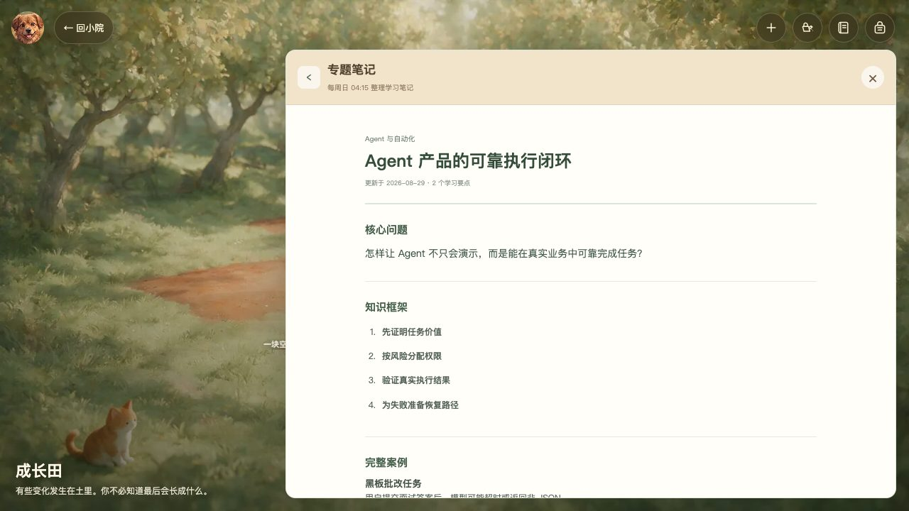
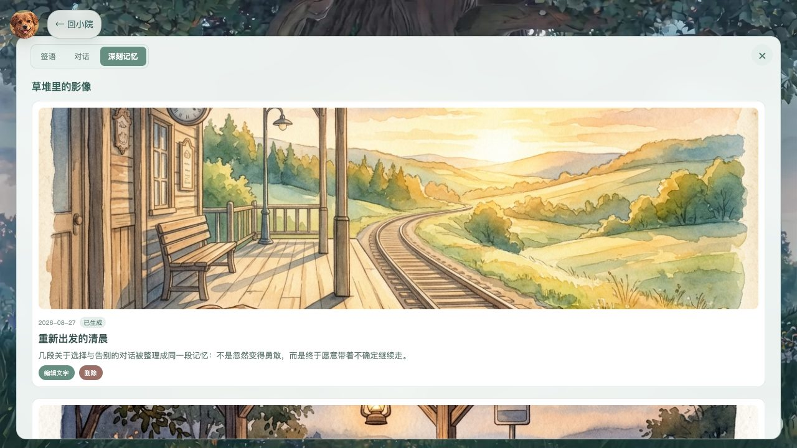
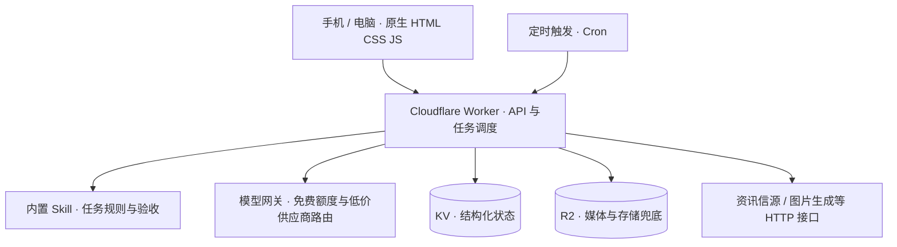

<div align="center">
  
  <h1>阿栗 · AI 个人成长小院</h1>
  <p><strong>让看过的资讯、想过的问题、说过的话，成为可以继续生长的积累。</strong></p>
  <p>资讯获取 · 思考训练 · 多轮学习 · 有依据的长期记忆</p>
  <p>
    <a href="https://labixy1.github.io/chestnut-courtyard-public/"><strong>进入小院</strong></a> &nbsp; / &nbsp;
    <a href="https://labixy1.github.io/chestnut-courtyard-public/assets/demo/videos/index.html?device=desktop">30 秒演示</a> &nbsp; / &nbsp;
    <a href="docs/README.md">产品与技术文档</a>
  </p>
</div>

<a href="https://labixy1.github.io/chestnut-courtyard-public/"></a>

阿栗是一个用空间组织任务的个人 AI 成长系统，而不只是另一个聊天窗口。它由产品经理定义需求、交互、任务规则与验收标准，通过持续对话、截图反馈和实际测试驱动 **Codex** 完成开发，采用原生网页与 **Cloudflare Worker / KV / R2** 部署。

> **公开演示与私人实例分开。** 在线预览使用虚构数据，可查看已有资讯、批改、聊天、专题与记忆；不会调用付费模型或处理私人内容。实时 AI、上传、定时任务与跨端同步需要自行部署服务。

## 先看 30 秒

<table>
  <tr>
    <td align="center" width="65%">
      <a href="https://labixy1.github.io/chestnut-courtyard-public/assets/demo/videos/index.html?device=desktop"></a><br>
      <strong>电脑端 · 场景式小院</strong><br>
      <a href="https://labixy1.github.io/chestnut-courtyard-public/assets/demo/videos/index.html?device=desktop">播放电脑端视频</a>
    </td>
    <td align="center" width="35%">
      <a href="https://labixy1.github.io/chestnut-courtyard-public/assets/demo/videos/index.html?device=mobile"></a><br>
      <strong>手机端 · 随时继续</strong><br>
      <a href="https://labixy1.github.io/chestnut-courtyard-public/assets/demo/videos/index.html?device=mobile">播放手机端视频</a>
    </td>
  </tr>
</table>

## 一条持续成长的路径

**读资讯 → 练思考 → 继续追问 → 整理知识 → 形成长期记忆。**

| 模块 | 用户得到什么 | 如何实现 |
| --- | --- | --- |
| **公告板** | 国内外资讯、中文摘要、AI 总结、产品关注点与阅读笔记 | 获取信源 → 筛选去重 → 模型整理 → 归档；Worker Cron 定时触发 |
| **黑板** | 有场景的题目、按证据评分、具体改进建议与参考回答 | 题目与评分规则 → 单次模型批改 → 结构校验 → 保存异步结果 |
| **成长田** | 多轮学习对话、专题笔记、可复习的收成背包 | 近期对话上下文 → 解惑 → 每周汇总聊天、答题与资讯笔记 |
| **密阁** | 成长档案、情感档案，以及可追溯的依据 | 原始记录 → 候选与生效记忆 → 按来源分开整理 → 支持撤销 |
| **树洞** | 一句话签语、陪伴对话、值得留下的记忆影像 | 文本/语音输入 → 模型回应；凌晨 4 点分析前一日窗口，必要时调用生图接口 |
| **旅行与卧室** | 旅程、照片与感悟，安静的场景互动 | 记录合并、R2 媒体保存；卧室保留灯光等本地互动 |
| **管家与工具箱** | 工具管理与受限任务执行 | 任务路由 → 受控工具调用 → 状态与结果核验；不等于无限自主 Agent |

### 手机上的四个入口

<table>
  <tr>
    <td align="center" width="25%"><br><strong>进入小院</strong></td>
    <td align="center" width="25%"><br><strong>读一份巡报</strong></td>
    <td align="center" width="25%"><br><strong>练一道题</strong></td>
    <td align="center" width="25%"><br><strong>继续学下去</strong></td>
  </tr>
</table>

### 留下来的不只是聊天记录

<table>
  <tr>
    <td width="50%"><br><strong>把碎片变成专题知识</strong><br>框架、逐层讲解、完整案例与复习要点集中在一篇笔记里。</td>
    <td width="50%"><br><strong>把具体经历留成影像</strong><br>合并相关对话后再判断是否值得生成，不为每句话强行画图。</td>
  </tr>
</table>

## 设计上的取舍

- **训练不是只给一个分数。** 评分基准先于答案确定，评分项需要引用原答案证据；给出差距与下一步，而不是一味鼓励或逐字匹配。
- **记忆不是无限拼接上下文。** 成长与情感依据分开，保留来源、适用范围、时效和撤回机制，避免一次倾诉被固化成长期判断。
- **Skill 是做法，不是神奇插件。** 内置任务规则统一输入、步骤、边界、输出与验收；实际执行仍由代码、模型网关和接口完成。
- **失败也是完整体验的一部分。** 异步状态、重复提交保护、模型降级和存储兜底用于处理真实失败，不把“已请求”包装成“已完成”。
- **公开分享不暴露私人生活。** 独立演示种子与发布扫描隔离真实记忆、答案、照片、日志及密钥。

## 架构一眼看懂



这是一个 **AI 应用系统，包含受限 Agent 能力**。公告抓取、批改、存储和定时更新有明确执行链，不统一称为 MCP。模型选择与额度取决于部署配置，免费额度耗尽后的外部供应商可能收费。具体接口与规则见 [AI 与接口调用链](docs/06-AI与接口调用链.md)。

## 运行与复用

**只看界面：** 打开 [在线演示](https://labixy1.github.io/chestnut-courtyard-public/)，或双击仓库的 `index.html`。静态浏览不需要 API Key。

**运行本地服务：**

```bash
cp .env.example .env
# 在 .env 中配置自己的模型供应商，勿提交密钥
python3 scripts/cozy_server.py --port 8766
```

打开 `http://127.0.0.1:8766/`。无需 npm、前端框架、数据库或 Docker。

<details>
<summary><strong>Cloudflare 部署与发布检查</strong></summary>

```bash
python3 scripts/build_cloud.py --mode owner
python3 scripts/cloud_owner_test.py
node scripts/cloud_worker_test.mjs
cd cloudflare
wrangler deploy --config wrangler.toml
```

口令、会话密钥和模型密钥通过 Cloudflare Secret 管理。配置自己的 KV / R2，不连接原作者实例。具体步骤见 [部署说明](cloudflare/README.md)。

```bash
python3 scripts/privacy_scan.py
python3 scripts/documentation_images_test.py
python3 scripts/repository_readiness_test.py
node scripts/html_syntax_test.js
```

公开静态预览由 GitHub Actions 构建发布，见 [预览与视频指南](docs/preview.md)。

</details>

## 文档导航

| 想了解 | 从这里开始 |
| --- | --- |
| 产品目标与体验 | [PRD](docs/01-PRD.md) · [使用指南](docs/02-使用指南.md) |
| 模块实现与数据关系 | [系统架构](docs/03-系统架构.md) · [功能规格](docs/04-模块与功能规格.md) |
| AI、Skill 与接口分工 | [调用链](docs/06-AI与接口调用链.md) |
| 数据与安全 | [同步与安全](docs/05-数据同步与安全.md) |
| 接手、测试与部署 | [Codex 协作指南](docs/08-Codex协作与迁移指南.md) · [测试与运维](docs/07-测试与运维手册.md) |

---

<div align="center">
  <strong>阿栗还在生长。</strong><br>
  一个从真实使用问题出发，持续迭代的个人 AI 产品。
</div>
