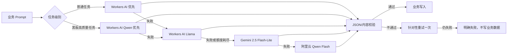
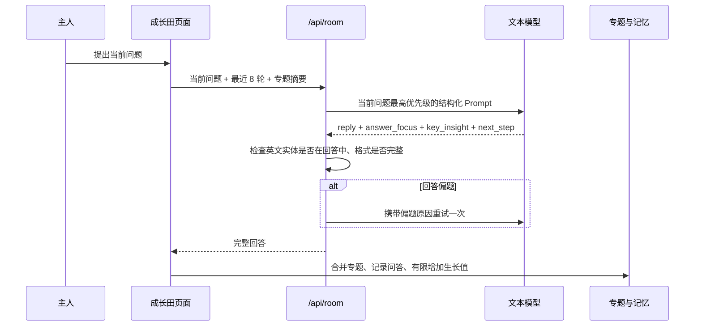
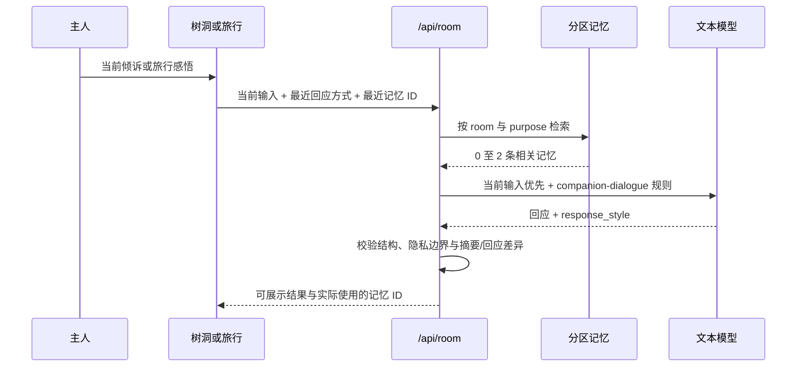
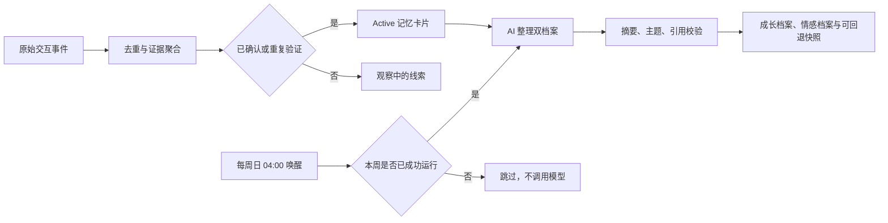
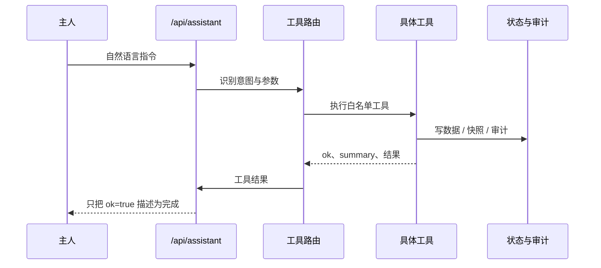

# AI 与接口调用链

## 1. 文本模型路由

当前私人云采用分级路由：

1. 普通任务优先 Cloudflare Workers AI `@cf/meta/llama-3.1-8b-instruct-fp8`，主要覆盖普通问答、翻译、摘要、树洞和旅行陪伴。
2. 黑板参考答案和正式批改优先同一 Workers AI 绑定下的 `@cf/qwen/qwen3-30b-a3b-fp8`；正式批改只调用一次，不做教学质量复检或追加答案生成。
3. 两个 Workers AI 模型均失败或免费额度耗尽后，依次调用 `gemini-2.5-flash-lite`、阿里云百炼 `qwen-flash`。只有配置 `DASHSCOPE_API_KEY` 后 Qwen Flash 才进入实际调用。
4. DeepSeek 欠费期间与 OpenAI、GLM 默认禁用，避免等待必然失败的接口或产生无边界费用。

路由只尝试已配置、未被禁用且可用的模型。每次失败被记录在本次调用中；所有模型失败时返回合并后的明确错误，不伪造答案。Cloudflare 当前提供每天 10,000 Neurons 免费额度，00:00 UTC 重置；免费套餐超过额度后继续调用会失败。额度和模型政策可能变化，仍以 Cloudflare 官方定价页为准。

`gpt-5.6-luna` 在本项目中只作为文本模型调用。图片生成使用独立的 GPT Image、Gemini Nano Banana 或 Seedream 接口，不能因为文本模型名称推断其具备读图或生图能力。

## 2. 成长田问答

成长田回答阶段不注入无关的全局记忆，避免旧题、公告或其他房间内容盖过当前问题。已有专题只用于指代消解和答完后的归档。

## 3. 树洞与旅行陪伴

树洞使用 `heart_companion`：最多一条明确陪伴偏好；只有当前输入包含连续性表达时，才可再加入一条去隐私趋势。树洞原文不离开 `heart_only` 封存区。回答在 `listen`、`clarify`、`reframe`、`suggest`、`lighten`、`challenge` 中选择，并避开前两轮已用方式。

树洞提供两条回复链路。`oracle` 会先在前端聚合尚未完成的表达，达到长度后调用 `/api/room`，要求模型只返回一句 18 到 45 字的具体签语；`dialogue` 则保留多轮上下文，继续自然对话。北京时间每天 04:00，Cloudflare Cron 调用夜间整理函数，读取上一个 04:00 到当前 04:00 的完整对话。它先做具体性预筛，再由文本模型聚合同一事件的多段表达，判断是否值得生成影像，并将 2 到 5 个相关关键信息提炼成一个标题、一段摘要和一幅完整画面。通过后直接调用内部生图链路，成品自动进入草堆和私有 R2；没有明显记忆点或情感波动时不生成。

旅行使用 `travel_companion`：最多一条陪伴偏好和一条与当前 `trip_id` 相同的已保存感悟。AI 返回的 `summary` 与 `reply` 职责分开，前者只归档用户原意，后者才进行陪伴。预览请求携带 `commit=false`，不写记忆；“保存感悟”携带 `commit=true` 和稳定事件 ID，成功后写 `travel_only`。失败时保存忠实本地摘要，不伪造模型回应。

普通管家使用 `butler/general`：默认只读取学习与沟通偏好，不读取树洞；只有用户明确询问自己的旅行时才检索相关旅行事件。所有陪伴场景都允许零记忆，当前输入永远高于历史记忆。

## 4. 记忆整理与自动更新

密阁把长期内容整理成两份主人档案。成长档案只使用已确认或重复验证的 active 卡片，形成学习方式、长期方向、知识与产品关注等连续报告；情感档案独立读取有界的树洞与旅行记录，整理内在轨迹，并可保留少量可追溯的真实触动片段。情感档案仅在主人版展示，不进入普通问答检索。

Cloudflare Cron 在北京时间每周日 04:00 唤醒 Worker；同一周重复触发会直接跳过。手动整理不改变自动节奏。写入前分别校验成长模块的 `source_card_ids`、情感模块的 `source_event_ids`，真实摘录还必须能在原记录中逐字找到；不合格时保留旧档案。每次成功前保存 90 天快照，可在密阁撤销上一次整理。

两份档案使用独立依据：成长档案只读取黑板、成长田、资讯笔记以及已确认的学习和工作记忆；情感档案只读取树洞对话与旅行记录。旅行记录不会作为成长偏好，学习记录也不会被推断成情感轨迹。密阁页面只展示两份档案及各自的人类可读依据，权限开关、Skill 清单、任务卷宗和整理按钮属于系统设置，不在密阁展示。

## 5. 黑板调用

### 出题

输入包含日期、近期题型、用户“以后想练什么”、近期巡报和非封存记忆。输出必须有问题、题型、最多两条资料和 4 至 6 个标准要点。

每日首次出题可以调用模型并按日期缓存；用户手动“换一题”时优先从经过人工编写和验证的内置题库按分类轮换，不等待模型现场生成。页面同时排除当前题、本次会话看过的题和历史已答题；题库耗尽时才回到模型生成。同日换题仍使用独立 variant 缓存键，单次前端等待上限为 30 秒。

正式批改只调用模型一次，一并生成评分、证据、教学建议、大白话讲解、下一题及其作答思路。不再生成“结合原答案的升级回答”和“下一题阿栗答案”，也不因语义质量做二次生成。首选模型失败时，模型网关仍可按既定供应商顺序切换通道。

### 题边小助手

只补当前题目的背景概念，返回 `reply` 和一条可独立阅读的附属资料。它不能提前泄露标准答案或替用户完成方案。

### 评分

模型返回四维评分、证据理由、诊断、大白话教学和后续练习。后端只做 JSON 解析、字段归一化和总分重算，不信任模型自报总分，也不再因教学内容质量自动重试。模型通道或 JSON 解析失败时保留原答案并提供重新批改按钮。

## 6. 公告更新

1. 根据固定来源、产品主题和主人关注方向构造查询。
2. 并发抓取 RSS；所有来源失败时抛出失败。
3. 规范化 URL 和标题，与全部历史巡报去重。
4. 无新候选时记录 `unchanged=true`，不新增版本。
5. 模型从候选中挑选 7 至 11 条并生成忠实摘要、判断与建议。
6. 校验 `source_id` 必须来自候选，再写入新巡报。

“主人关注”只有候选确实匹配时才生成。留言找到的内容与本期其他区块再次去重。

同一篇文章在“热点速览、国内外动态、产品相关动态、主人关注”之间也使用共享去重集合，不能跨栏目重复出现。页面保留案例总结，不再展示低价值的整理状态和“阿栗的建议”。

## 7. 阿栗工具调用

系统修改类工具需要掌院权限，先创建快照，再限制修改文件和行数，运行验证后才提交。超时、权限不足、验证失败或工具不存在都显示“无法执行”。

## 7. 记忆调用

- 输入先生成 evidence event，再由规则判断工作记忆、长期候选或封存。
- 回答检索先按 `learning_format`、`companion_style`、`heart_only`、`travel_only`、`topic_selection`、`review_only`、`record_only` 分区，再做相关性排序。
- 普通回答只返回当前任务允许的非封存卡片；树洞封存原文不能进入普通检索。
- 管家与陪伴对话每轮最多两条记忆，可返回零条；请求中的 `recent_memory_ids` 会阻止近期内容连续重复。
- `room_id` 把旅行记忆限制在对应旅程；只有明确询问旅行时，普通管家才可跨房间检索一条相关事件。
- AI 提炼输出结构化 proposal；确定性代码校验证据数量、卡片 ID、冲突关系和封存边界。
- proposal 原子应用，失败不部分写入；每次运行保存 before/after 摘要与回滚记录。

## 8. 主要 API

| 路径 | 方法 | 功能 |
| --- | --- | --- |
| `/api/status` | GET | 运行模式、权限、存储和演示激活状态 |
| `/api/local-state` | GET/POST | 读取或增量合并浏览器结构化状态 |
| `/api/state/sync` | POST | 工具箱与管家状态同步 |
| `/api/assistant` | POST | 全局阿栗回答与工具执行 |
| `/api/room` | POST | 成长田、黑板、树洞、旅行的结构化 AI |
| `/api/blackboard/today` | GET | 获取或生成每日题目 |
| `/api/weekly/run` | POST | 启动资讯更新任务 |
| `/api/automation` | GET | 自动化运行状态 |
| `/api/memory*` | GET/POST | 记忆、事件、动作、提炼与状态 |
| `/api/media*` | GET/POST | 上传、生成和任务查询；云端媒体受 R2 限制 |
| `/api/sync/export` | GET | 导出完整私人结构化快照 |
| `/api/sync/import` | POST | 高权限导入云端快照 |
| `/api/backup/run` | POST | 创建全量备份 |
